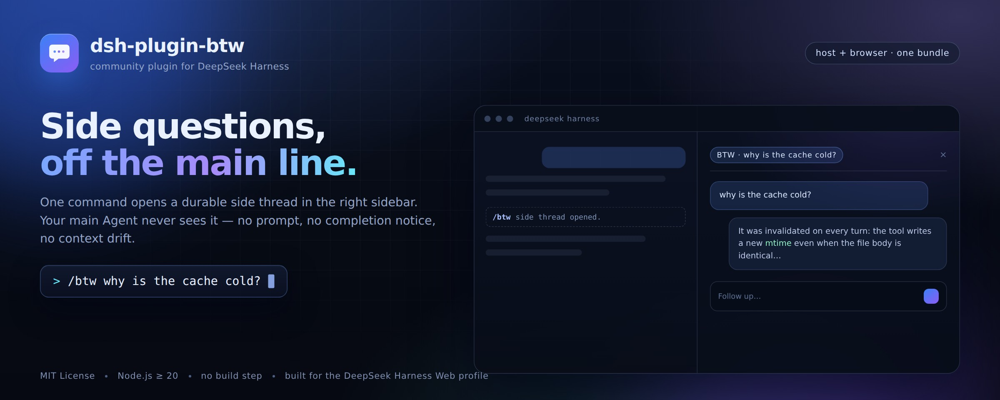

<div align="center">



<h1>dsh-plugin-btw</h1>

<p><strong>Ask a side question in DeepSeek Harness without touching the main conversation.</strong><br />
One command opens a durable side thread in the right sidebar. The main Agent never sees it.</p>

[![Version][version-badge]][package]
[![License][license-badge]][license]
[![Node.js][node-badge]][node]
[![Platform][platform-badge]][harness]
[![No build step][build-badge]](#how-to-dev)
[![Tests][tests-badge]](#how-to-dev)

</div>

---

## Introduction

`/btw` is for the question that is *about* the work but not *part of* it: "why is this cache cold?",
"what does this flag do?", "can you check whether that file is still generated?". It runs in its own
durable thread, inherits the conversation's completed turns, and answers in the right sidebar while
the main thread keeps its context, token budget, and attention untouched.

| Command | Behavior |
|---|---|
| `/btw <question>` | Continue the newest **idle** `/btw` thread of this conversation, or open a new one. |
| `/btw new <question>` | Always open a fresh side thread. |
| `/btw` | Prints the usage hint; nothing is sent. |

The target thread opens in the right sidebar automatically and stays docked next to the main
conversation. Its own composer handles follow-ups and Stop; the thread remains reachable from the
conversation header's subagent catalog after the tab is closed.

### Why the main conversation stays clean

- **Model context** — the first side turn is delivered with `caller` delivery, so the main Agent
  receives no completion notice. Every later turn cold-resumes the durable child; the plugin filters
  the runtime's settlement notice out of the parent inbox before it can become a user message.
- **Chat stream** — the main conversation gains one log-only `/btw` command row, never the question
  or the answer.
- **Capacity** — side threads release their subagent activation when a turn settles, so idle threads
  do not consume the main Agent's delegation budget.

The side thread is deliberately *not* sandboxed from the workspace: it inherits the conversation's
preset, model, permission roots, and working directory, so a `/btw` can also perform a small
operation. Approvals it raises render in its own tab.

### Good to know

- Only **completed turns** are inherited; work in the main Agent's open turn is invisible to a side
  thread.
- A continued question arrives as an adjacent-Agent message, so the side transcript attributes it to
  the parent Agent rather than to a typed human message.
- The native right-sidebar layout is in memory: after a page reload the tab is gone (the thread is
  not — reopen it from the subagent catalog or ask `/btw` again).
- A suppressed settlement notice may leave one empty turn boundary in the main log (no step, no model
  call, no content).

---

## How to Install

### Requirements

- DeepSeek Harness with the **Web** surface (`dsh web` or the Desktop web surface).
- The composed `subagents` service with the **`fork`** provider
  (`@deepseek-ai/dsh-subagent-fork-in-process`, `providerName: fork`), which the
  `@deepseek-ai/dsh-base` bundle mounts by default.
- Session persistence — a side thread is a durable child Session.

### From the Harness Web UI

1. Open **Plugins** in the Harness Web UI.
2. Install this package directory as a **local bundle**.
3. The bundle inserts one Host row (`btw`) and ships its browser half in the same package.
4. **Reload the page once** so the browser module loads, then type `/btw` in any conversation.

### From an agent or automation

The same installation is available to an agent through the plugin manager tool:

```text
plugin_manager install_bundle target=/absolute/path/to/dsh-plugin-btw
```

The result reports `application: applied` when the host row activates; the browser half appears after
the next page load. A first install of a new bundle does not require restarting the Harness process.

### Verify

`/btw` should appear in the `/` command menu with its description. Send:

```text
/btw what is this repository's license?
```

The right sidebar should open a `BTW · what is this repository's license?` tab and stream the answer,
while the main conversation shows only a `btw · Side thread opened.` row.

---

## How to Dev

Plain ESM host code plus one hand-written browser module — **no bundler, no build step**.

```bash
git clone https://github.com/Dynesshely/dsh-plugin-btw.git
cd dsh-plugin-btw

node --version        # >= 20
npm test              # node:test suite for the command, label, and thread-selection logic
npm run check         # syntax-check every runtime file
```

Install the working tree into a profile and iterate against a running instance:

```bash
dsh plugin --profile web add /absolute/path/to/dsh-plugin-btw
```

Then make sure `dsh-plugin-btw` is an active bundle for that profile (Plugins page) and reload the Web
page once. While developing:

- **Host code** (`src/`) is loaded when the plugin row activates. Toggle the plugin off and on in the
  Plugins page to pick up changes — no Harness restart needed.
- **Browser code** (`client.js`) is fetched per page load; a page refresh is enough.
- The plugin deliberately declares no `Config` schema in v0.1, so there is no live form to reload.
- Design notes and the DSH extension points this plugin relies on live in
  [`docs/DESIGN.md`](docs/DESIGN.md).

> Iterating on a plugin should never require restarting someone else's live Harness instance. Reload
> the plugin row and the page instead.

---

## Structure

```text
dsh-plugin-btw/
├── package.json            # bundle manifest: dsh.bundle.patch + dsh.client
├── cordis.patch.yml        # inserts the single Host row (`btw`)
├── src/
│   ├── index.js            # plugin entry: /btw command, lifecycle
│   ├── btw.js              # thread resolution, delivery, parent inbox filter
│   ├── label.js            # pure command grammar, label budget, boundary prompt
│   └── threads.js          # pure catalog selection + liveness probe
├── client.js               # browser half: btw resource, right-sidebar tab, auto-reveal
├── test/                   # node:test suites for the pure modules
├── locale/en.json          # Plugin Manager display metadata
├── icon.svg                # plugin icon (original artwork)
├── assets/
│   ├── banner.jpg          # rendered README banner
│   └── banner.html         # self-drawn banner source (rendered with Chromium)
├── docs/DESIGN.md          # architecture, DSH contracts, decisions, limitations
├── README.md
└── LICENSE
```

**How the pieces fit:** the Host half registers `/btw`, resolves or creates a continuable child of the
current conversation (the official `fork` provider seeds it with the completed-turn prefix), and
delivers the question. The browser half registers the `btw` resource protocol and tab type, then
renders the shared `conversation.content` Factory with the Chat view pinned — so streaming output,
history paging, tool cards, approval cards, and the composer all come from the product
implementation, not from a second transcript engine.

---

## Star History

<div align="center">

<a href="https://star-history.com/#Dynesshely/dsh-plugin-btw&Date&theme=dark">
  <picture>
    <source media="(prefers-color-scheme: dark)" srcset="https://api.star-history.com/svg?repos=Dynesshely/dsh-plugin-btw&type=Date&theme=dark" />
    <source media="(prefers-color-scheme: light)" srcset="https://api.star-history.com/svg?repos=Dynesshely/dsh-plugin-btw&type=Date&theme=dark" />
    
  </picture>
</a>

</div>

---

## LICENSE

[MIT](LICENSE) © 2026 Dynesshely

<!-- badge links -->
[version-badge]: https://img.shields.io/badge/version-0.1.0-3b82f6?style=flat-square
[license-badge]: https://img.shields.io/badge/license-MIT-22c55e?style=flat-square
[node-badge]: https://img.shields.io/badge/node-%3E%3D20-339933?style=flat-square&logo=nodedotjs&logoColor=white
[platform-badge]: https://img.shields.io/badge/platform-DeepSeek%20Harness%20Web-6f42c1?style=flat-square
[build-badge]: https://img.shields.io/badge/build-none-success?style=flat-square
[tests-badge]: https://img.shields.io/badge/tests-11%20passing-brightgreen?style=flat-square

[package]: package.json
[license]: LICENSE
[node]: https://nodejs.org/
[harness]: https://github.com/deepseek-ai/deepseek-harness
